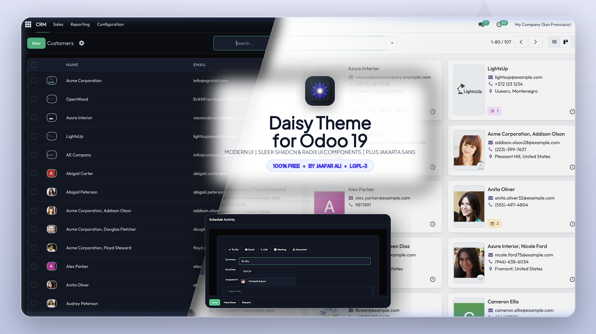
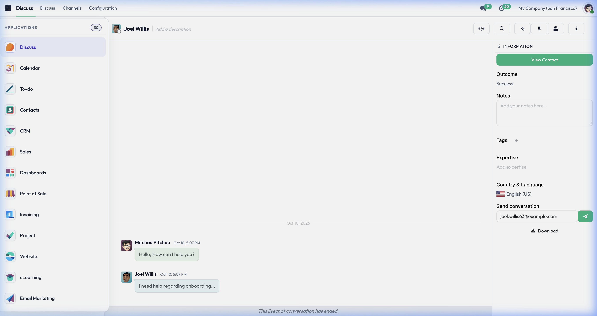
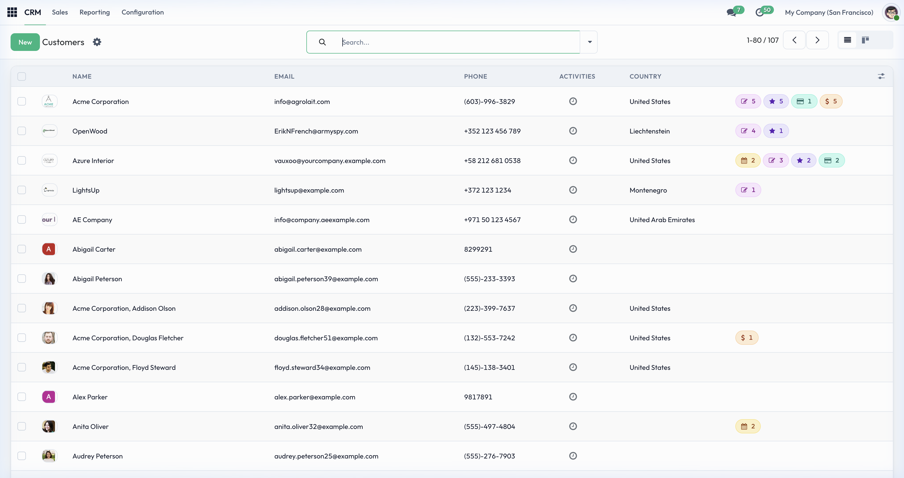
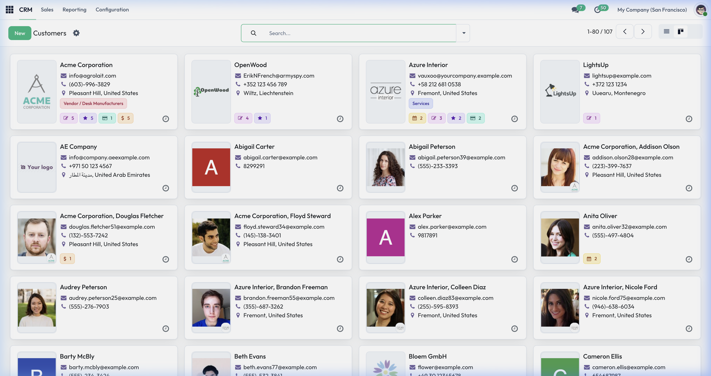
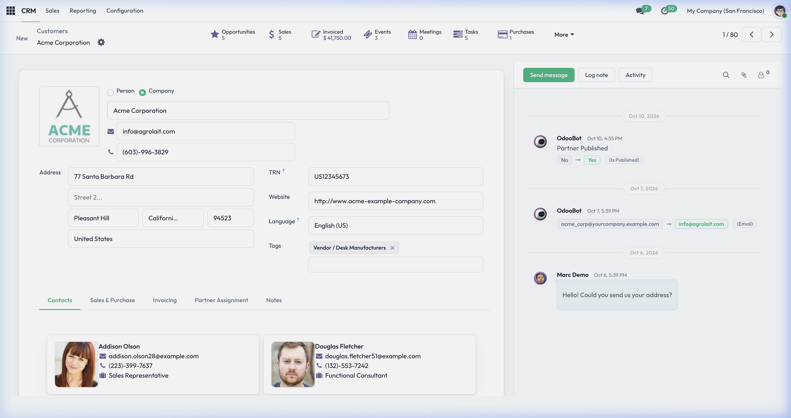
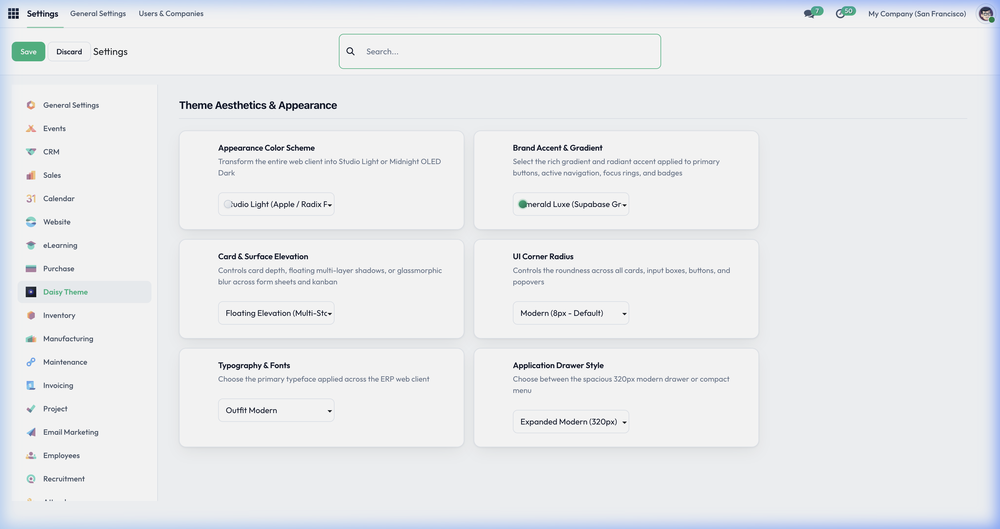
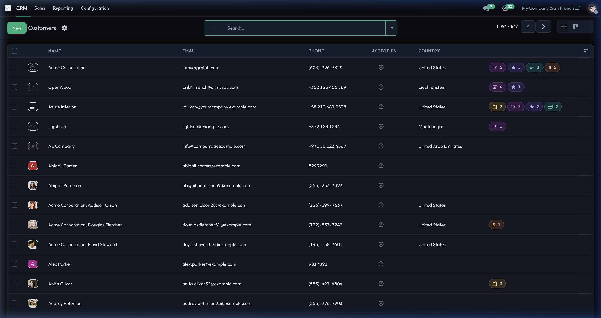

# Odoo Web Theme Daisy

<p align="center">
  
</p>

<p align="center">
  <strong>A modern, state-of-the-art ERP &amp; Website theme inspired by shadcn/ui and Radix UI design systems.</strong>
</p>

<p align="center">
  <a href="https://www.odoo.com"></a>
  <a href="https://www.gnu.org/licenses/lgpl-3.0"></a>
  <a href="#"></a>
  <a href="#"></a>
  <a href="#"></a>
</p>

---

## 🌟 Overview

**Daisy Theme** transforms the entire Odoo 19 experience into a sleek, modern, and accessible software product. Drawing inspiration from modern design benchmarks like **shadcn/ui**, **Radix UI**, **Linear**, and **Vercel**, Daisy Theme introduces:

- **Minimalist Elevation Hierarchy**: Clean 1px borders, multi-stop soft ambient shadows, and accessible focus rings.
- **Studio Light & Midnight OLED Dark**: High-contrast, meticulously calibrated light and dark modes with zero eye fatigue.
- **7 Curated Designer Palettes**: Dual-tone gradients and accent colors configured for buttons, badges, navigation, and active states.
- **Google Fonts Typography**: Pre-configured with *Plus Jakarta Sans*, *Inter*, *Outfit*, and *Roboto*.
- **Real-Time Live Customizer**: Configure appearance, brand colors, typography, card elevation, and corner radius directly from Odoo Settings with instant preview.

---

## 📸 Visual Showcase

### 1. Unified Navigation & Dashboard
A sleek top navigation bar with clean module icons, active state indicators, and refined systray popovers.



---

### 2. Minimalist Data Tables (List View)
Crisp uppercase headers, Radix status chips, clean checkboxes, and smooth row hover transitions with dedicated delete actions.



---

### 3. High-Elevation Kanban Board
Floating multi-stop ambient shadows, clean stage columns, and distinct tag chips.



---

### 4. Modern Form Sheet & Social Chatter
Clean form cards with Radix stage dropdowns, checkmark indicators, structured button boxes, and a refined social chatter stream.



---

### 5. Instant Theme Customizer (Settings)
A dedicated configuration panel located at **Settings → Daisy Theme** offering live switching for color schemes, theme accents, card elevation, border radius, and typography fonts.



---

### 6. Midnight OLED Dark Mode
Deep zinc/slate backgrounds, tailored dark scrollbars, and high-contrast text rendering inspired by Linear and Raycast.



---

## 🚀 Key Features

| Feature | Description |
|---|---|
| **🌙 Dual Color Schemes** | Studio Light (Apple / Radix Pro) and Midnight OLED Dark (Linear / Vercel Pro). |
| **🎨 7 Accent Palettes** | Electric Indigo, Emerald Luxe, Cyber Sky, Velvet Violet, Sunset Rose, Sunburst Amber, and Titanium Monochrome. |
| **🔤 Typography Engine** | Google Fonts integration (*Plus Jakarta Sans*, *Inter*, *Outfit*, *Roboto*) with tabular numeric support. |
| **📱 Mobile Responsive** | Optimized layouts for desktop, tablet, and mobile screens. |
| **⚡ Zero FOUC** | LocalStorage caching ensures instantaneous theme rendering with zero flash of unstyled content. |
| **🧩 100% Core Compatible** | Seamlessly works with all standard Odoo apps (CRM, Sales, Accounting, Inventory, Project, HR, Website, etc.). |

---

## 📦 Installation Guide

### Step 1: Copy Addon
Place the `website_daisy` directory into your Odoo custom addons path:
```bash
cp -r website_daisy /path/to/odoo/custom_addons/
```

### Step 2: Update Addons Path
Ensure your `odoo.conf` includes the custom addons directory:
```ini
addons_path = /path/to/odoo/addons,/path/to/odoo/custom_addons
```

### Step 3: Install via Odoo Interface
1. Restart your Odoo server.
2. Log in as an Administrator and activate **Developer Mode** in **Settings**.
3. Navigate to **Apps → Update Apps List**.
4. Search for **"Daisy Theme"** in the search bar.
5. Click **Activate** (Install).

---

## ⚙️ Configuration & Customization

Once installed, navigate to:
> **Settings → General Settings → Daisy Theme**

From this panel, you can customize:
1. **Appearance Color Scheme**: Toggle between Studio Light and Midnight OLED Dark.
2. **Brand Accent & Gradient**: Select from 7 designer dual-tone color palettes.
3. **Card & Surface Elevation**: Choose between Floating Elevation, Glassmorphic Frosted, or Crisp Minimalist.
4. **UI Corner Radius**: Select Sharp (4px), Modern (8px), or Smooth Curved (12px).
5. **Typography Font**: Switch between *Plus Jakarta Sans*, *Inter*, *Outfit*, and *Roboto*.
6. **Application Drawer Style**: Choose between Expanded Modern (320px) or Compact Classic (240px).

> 💡 **Tip:** Changes update immediately on click via the live preview engine. Click **Save** to persist your preferences globally across all users.

---

## 📁 Module Structure

```
website_daisy/
├── __init__.py
├── __manifest__.py
├── README.md
├── models/
│   ├── __init__.py
│   └── res_config_settings.py
├── views/
│   └── res_config_settings_views.xml
├── data/
│   ├── generate_primary_template.xml
│   └── presets.xml
└── static/
    ├── description/
    │   ├── icon.png
    │   ├── cover.png
    │   ├── index.html
    │   ├── screenshot_dashboard.png
    │   ├── screenshot_list_view.png
    │   ├── screenshot_kanban_view.png
    │   ├── screenshot_form_view.png
    │   ├── screenshot_settings.png
    │   └── screenshot_dark_mode.png
    └── src/
        ├── js/
        │   ├── theme.js
        │   └── theme_config.js
        ├── scss/
        │   ├── primary_variables.scss
        │   ├── bootstrap_overridden.scss
        │   ├── theme.scss
        │   ├── animations.scss
        │   ├── backend/
        │   │   ├── theme_backend.scss
        │   │   ├── settings_view.scss
        │   │   ├── form_view.scss
        │   │   ├── list_view.scss
        │   │   ├── kanban_view.scss
        │   │   ├── activity_view.scss
        │   │   ├── calendar_view.scss
        │   │   ├── analytics_view.scss
        │   │   ├── search_panel.scss
        │   │   ├── fields_widgets.scss
        │   │   ├── components.scss
        │   │   ├── discuss.scss
        │   │   ├── chatter.scss
        │   │   └── overlays_popovers.scss
        │   └── frontend/
        └── xml/
            ├── navbar.xml
            ├── select_menu.xml
            └── statusbar.xml
```

---

## 🛠️ Technical Specifications

- **Odoo Version**: 19.0 (Community &amp; Enterprise Editions)
- **Framework**: OWL (Odoo Web Library) &amp; Bootstrap 5
- **Dependencies**: `web`, `website`
- **License**: LGPL-3 (GNU Lesser General Public License v3.0)
- **Price**: Free ($0 / €0)

---

## 👤 Author & Maintainer

- **Author**: Jaafar Ali
- **License**: [LGPL-3](https://www.gnu.org/licenses/lgpl-3.0.html)

---

<p align="center">
  <sub>Daisy Theme is free and open-source software built for the global Odoo community.</sub>
</p>
